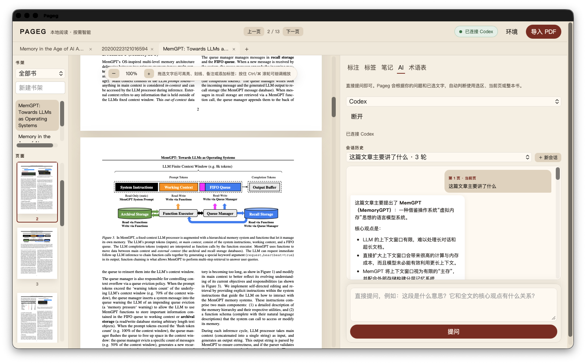

# Pageg

Pageg 是一个面向长文档阅读的本地 AI PDF 阅读器。它把 PDF 阅读、可恢复的标注和书籍级 AI 对话放在同一个桌面工作区里，让你可以边读边问，并且在切换书籍时自动切换 AI 上下文。



## 功能

- **三栏阅读工作区**：左侧书架和页面缩略图、中间 PDF 阅读器、右侧 AI 面板。左右分隔线可以直接拖动，也可以在设置中调整并持久化。
- **PDF 常用操作**：文本选择、复制、高亮、下划线、删除线、备注和自定义标签。标签可以从标签面板直接定位回原文页面。
- **细致缩放**：工具栏的 `− / +` 按钮，以及按住 `Ctrl`（macOS 为 `⌘`）滚动鼠标滚轮进行细调。
- **书架和书桌**：导入的 PDF 会进入本地书库，书架支持文件夹式整理和元数据编辑，最近阅读的书会保留在书桌视图中。
- **自动文献索引**：导入 PDF 后提取标题、作者、摘要等可识别信息，并在本地建立索引，方便搜索和后续 AI 提问。
- **书籍级上下文**：切换 PDF 时，阅读页、选区、标签、笔记和 AI 会话随当前书籍切换，避免把上一本文献的内容带到下一本。
- **会话历史**：右侧 AI 区支持新建会话、切换历史会话和继续追问；历史记录按书籍保存。
- **智能范围判断**：只需要一个提问框。Pageg 会结合当前选中文字、当前页和整本书内容，判断适合的上下文范围，不需要用户手动选择模式。
- **论文搜索与下载**：在 AI 区说“帮我下载这篇论文”即可。代理返回可靠 PDF 地址时由 Pageg 校验并下载；没有直链时自动用 arXiv 公开索引搜索，下载后完成本地索引并打开到书桌。
- **Markdown / LaTeX**：AI 回复支持标题、列表、表格、代码块、引用和 LaTeX 数学公式渲染。
- **中英文界面**：在「环境 / Settings」中切换简体中文或 English，语言和布局设置会保存到本机。
- **本地优先**：书库、标注、笔记和会话保存在本地 vault。AI 通过本机已安装的 ACP（Agent Client Protocol）命令行代理连接。

## 技术路线

Pageg 使用 Rust + Tauri 2 + React + pdf.js：

```text
┌────────────────────────────────────────────────────────────┐
│ React / TypeScript                                          │
│ 书架 · PDF 文本层与标注 · AI 会话 · Markdown / KaTeX        │
└──────────────────────────────┬─────────────────────────────┘
                               │ Tauri commands / events
┌──────────────────────────────┴─────────────────────────────┐
│ Rust / Tauri 2                                              │
│ 本地 vault · 文件与设置 · ACP JSON-RPC · agent 生命周期     │
└──────────────────────────────┬─────────────────────────────┘
                               │ stdio
                    Codex / Claude / Gemini CLI
```

Rust 负责进程生命周期、本地文件、设置持久化和 ACP 通信；React/pdf.js 负责 PDF 的文本层、选区、渲染和交互。Tauri 提供同一套代码到 macOS、Windows 和 Linux 的打包边界，避免为每个平台维护一套阅读器 UI。

Pageg 不内置模型，也不会把 PDF 自动上传到远端服务。连接 AI 时，Rust 会启动本机可用的 ACP 代理，并把当前书籍中与问题相关的内容交给代理处理。桌面启动时还会补充 Homebrew、NVM、fnm、Volta、Cargo 和用户目录中的常见 CLI 路径。

论文搜索和下载需要网络连接；Pageg 只接受 HTTPS 地址，并在写入书库前检查文件是否为有效 PDF。

## 快速开始

### 环境要求

- Node.js 22+
- Rust stable（推荐通过 rustup 安装）
- macOS 11+、Windows 10/11 或安装了 Tauri WebKitGTK 依赖的 Linux
- 可选：本机安装并登录 Codex、Claude 或 Gemini 等 ACP 代理

### 开发运行

```bash
git clone https://github.com/LightingMax/pageg.git
cd pageg
npm ci
npm run tauri dev
```

### 构建安装包

在目标系统上执行对应命令：

```bash
# macOS：.app 和 .dmg
npm run bundle:mac

# Windows：NSIS 安装程序
npm run bundle:windows

# Linux：AppImage 和 deb
npm run bundle:linux
```

产物位于 `src-tauri/target/release/bundle/`。Apple Silicon 和 Intel macOS 安装包建议分别在对应架构的机器上构建。

### 测试和检查

```bash
npm test -- --run
npm run build
cargo check --manifest-path src-tauri/Cargo.toml
```

## 使用提示

1. 点击「导入 PDF」，或把 PDF 拖入 Pageg 的书桌区域。
2. 在左侧书架选择书籍和页面；中间文本层支持拖选。
3. 选中文字后可以直接复制、标注、添加标签或发送到 AI。
4. 在右下角提问框输入自然语言问题。Pageg 会自动判断使用选区、当前页或整本书。
5. 如果想找论文，直接输入“帮我搜索并下载 mem0 的论文”。找到的 PDF 会自动进入书桌并打开。
6. 在「环境 / Settings」中切换语言、调整左右栏宽度，或恢复默认布局。

## 仓库结构

```text
src/                         React + TypeScript 界面
src/components/PdfPane.tsx   PDF 页面、文本层、缩放和标注
src/components/SidePanel.tsx AI、标签、笔记、术语表和会话历史
src/components/DeskHome.tsx 书桌、书架和文献索引
src/lib/i18n.ts              中英文文案和插值函数
src-tauri/src/acp.rs         ACP JSON-RPC 客户端
src-tauri/src/vault.rs       本地书库、设置和会话持久化
skills/                      注入书本 vault 的阅读技能
docs/                        项目文档和界面截图
```

## 开源许可

Pageg 以 [MIT License](LICENSE) 发布。第三方依赖分别遵循其各自许可证。

欢迎提交 Issue 和 Pull Request：可以从 PDF 交互、跨平台打包、AI 代理适配和阅读工作区设计等方向参与改进。
